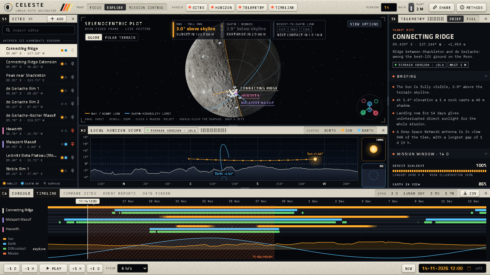
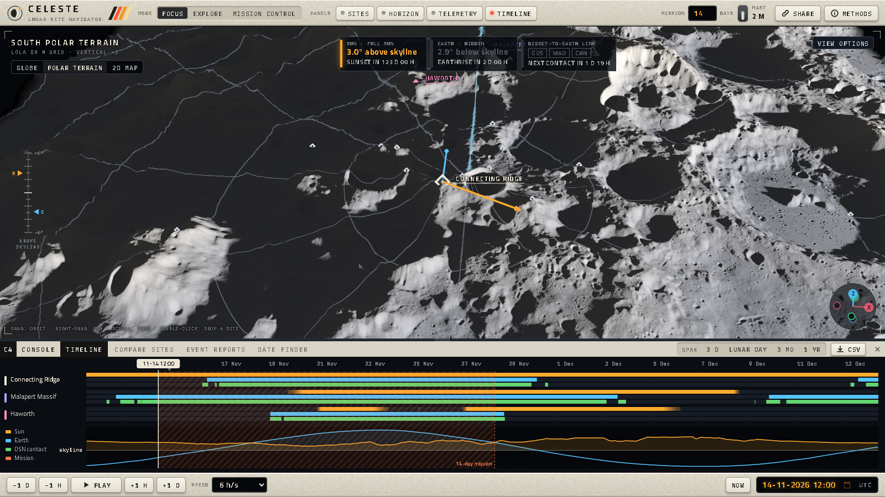
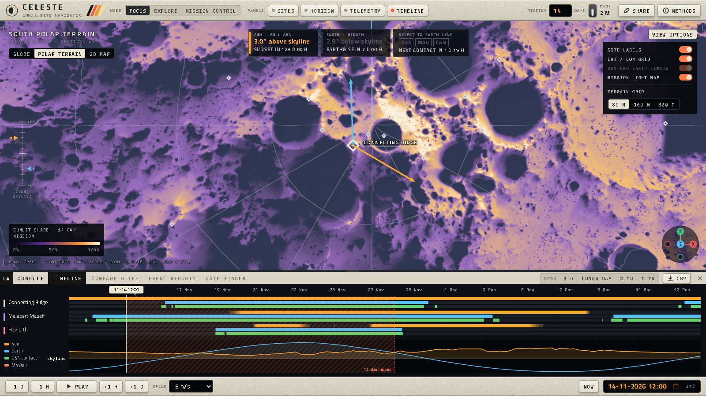

# CELESTE · Lunar Landing Site Navigator

**NASA Space Apps Challenge 2026 · Lunar Landing Site Navigator**

Pick a landing site and a date. CELESTE shows where the Sun and the Earth are against the
site's real terrain horizon, how long until sunset or Earthset, which Deep Space Network
antenna can reach it, and how a mission starting then compares with other sites or other dates.



## Run it

```bash
npm install
npm run dev        # http://localhost:5173
```

Node 22.18 or newer. Everything needed to run is in the repository; no API keys, no server.
`npm run build` produces a static site in `dist/` that can be hosted anywhere.

## Three ways to use it

The 3D view is the centre of the screen. Everything else is a panel that can be hidden,
shown and drag-resized, with three presets on the top rail:

| Mode | For | What is on screen |
|---|---|---|
| **Focus** (`1`) | Presenting, exploring the Moon | The 3D view and the timeline. Sun, Earth and link status with countdowns stay on the view itself. |
| **Explore** (`2`) | Educators, students, a first look | Adds the site list, the horizon scope and a plain-language briefing with "Here versus Earth" comparisons. |
| **Mission control** (`3`) | Mission planners | Every readout: trackers, DSN stations, solar power, comparison table, event reports, date finder. |



## Challenge coverage

| Objective | In CELESTE |
|---|---|
| Site selection and comparison | 39 curated sites: the 13 Artemis III candidate regions, south-pole science sites, CLPS and commercial landers, ISRO / JAXA / CNSA missions, Apollo. Custom coordinates by form or by double-clicking the Moon. Up to five sites side by side. |
| Date and time flexibility | Any date from 1960 to 2100. Step, scrub or play from 10 min/s to 5 days/s. The **date finder** scores every possible landing date and lists the best. |
| Sun and Earth relative to the horizon | A 360° panorama of the terrain skyline with both bodies, their tracks, and each disk against the skyline at true scale. Countdown to the next sunrise, sunset, Earthrise or Earthset, always visible. |
| Power and communication | Solar elevation angle, visible fraction of the solar disk, direct irradiance, array output and mission energy for three array geometries. Earth visibility and two-way line of sight to Goldstone, Madrid and Canberra. |
| Multiple visualisations | 3D globe with the day/night line and the Earth-visibility limit (`G`); 3D south-polar terrain with GPU ray-marched shadows; 3D & 2D Earth-to-Moon flight trajectory simulator with cinematic chase camera (`F`); heliocentric solar system orrery (`O`); top-down 2D map; mission-illumination map; skyline panorama; timeline. |
| Flight dynamics & 104 missions | Interactive Earth-to-Moon trajectory reconstruction for all 104 catalogued lunar missions ever launched (Apollo, Artemis, Luna, Chang'e, Chandrayaan, Surveyor, Lunar Orbiter, Pioneer, SLIM, CLPS). Procedural 3D aerospace models (Saturn V, SLS Block 1, Falcon 9, R-7, Lunar Module, robotic landers) with multi-stage separation, throttleable flame plumes, telemetry readouts (MET, speed, Earth/Moon distance, phase), jump controls (Liftoff, TLI, LOI, Touchdown), and direct landing-site linking. |
| Temporal dynamics | Animated playback everywhere. Timeline lanes for sunlight, Earth and DSN from three days to a year. Event reports for every dark interval and DSN pass, with CSV export. |
| All skill levels | The three modes above. Exact numbers with units and provenance for planners; the same numbers in plain words for everyone else. |
| No atmosphere, real topography, libration | No refraction term; skylines traced on LOLA grids; the IAU lunar rotation model carries the librations (visible as Earth's monthly loop in the horizon scope). |
| Why small changes matter | The mission-illumination map goes from near 100% to 0% sunlit within a few kilometres; the mast switch shows what eight metres of height buys. |

### The challenge's resources

- **JPL Horizons**: every Sun and Earth angle is validated against it (below), and the
  Telemetry panel links to Horizons' own answer for the site and time on screen.
- **LROC QuickMap and NASA Moon Trek**: CELESTE uses the same LRO/LOLA topography those tools
  display, taken directly from NASA's archive, and links to both for the selected site.
- **CSA Moon exploration portal**: linked from Methods as background on current missions.



## Why the numbers can be trusted

- **Checked against JPL Horizons.** Sun and Earth azimuth and elevation from six lunar surface
  sites, 1,620 samples across January 2026 to June 2027, agree with NASA/JPL Horizons (DE441,
  same lunar reference frame) to within **0.0045°** worst case. The Sun's disk is 0.53° wide.
- **Real terrain, finest grid nearest the site.** Each skyline is 1,440 rays marched out to
  350 km with the Moon's curvature handled exactly: LOLA 20 m/px within 10 km for sites inside
  87.5° S, 40 m/px within 30 km inside 85° S, 80 m/px out to 60 km, 240 m/px beyond. The app
  lists the grids behind each site.
- **Physical checks in the test suite.** Apollo 11 is sunlit half the time with Earth always
  up; Chang'e 4 on the far side never sees Earth; the floor of Shackleton never sees the Sun
  or the Earth.
- **Honest labels.** Where there is no terrain data the app says "ideal sphere". Nothing on
  screen is decorative: every lamp and readout is wired to a computed value.

```bash
npm test                 # 43 automated checks across 4 suites, about 4 s
npm run data:horizons    # re-fetch the JPL Horizons reference values
```

The **Methods** button in the app describes each calculation, its inputs and its limits.

## Performance and graphics quality

The polar view renders NASA's LOLA 80 m grid at full resolution: 7600 × 7600 samples from
80° S to the pole, per-pixel relief, and shadows marched through the height field on the GPU
on a 4096² shadow map. That is the default wherever the GPU can hold it. **View options**
offers 160 m and 320 m versions of the same product for lighter hardware.

Measured with `node tools/qa-perf.mjs` on an Intel Iris Plus 655 integrated GPU at 1600 × 900:

| Mode / benchmark | Frame rate & timing |
|---|---|
| Load to fully analysed (three sites, 455 days each) | ~2.8 s |
| One site, one year, 10-minute steps | ~127 ms |
| Globe view, playing at 6 h/s | 60.0 fps (median 16.7 ms) |
| Polar terrain at 80 m with live ray-marched shadows | ~46 fps (median 16.7 ms) |
| Earth-Moon flight trajectory, playing | 59.8 fps (median 16.7 ms) |
| Cinematic flight chase camera, playing | 60.0 fps (median 16.7 ms) |
| Heliocentric solar system orrery, playing | 60.0 fps (median 16.7 ms) |

How it stays interactive: long computations run in a Web Worker; Sun and Earth positions are
tabulated once and interpolated; the fine shadow map is refreshed one band per frame (exact
whenever the clock is still) with a small coarse map covering fast motion; charts draw on canvas
without going through React; the 3D scene only redraws when dirty.

## How it is built

```
src/core/      Science & dynamics. Ephemeris, lunar frames, horizon geometry, terrain ray tracing,
               104-mission catalogue, and patched-conics flight trajectory mechanics.
src/workers/   Analysis worker: year-long sweeps and custom-site horizon tracing (80 m grid).
src/gl/        three.js scene & GLSL: globe, polar terrain, GPU shadow march, procedural 3D
               spacecraft models (Saturn V, SLS, Falcon 9, R-7, Lunar Module, robotic landers).
src/ui/        React panels, heads-up display, flight HUD & mission directory, canvas charts.
src/state/     One store: selection, clock, analyses, workspace layout, flight & orrery view states.
src/data/      Site catalogue with a source for every coordinate; terrain index; mission database.
tools/         Data pipeline, Horizons fetcher, screenshot and performance probes.
tests/         Validation against Horizons, physical sanity checks, continuous flight reconstruction.
```

TypeScript, React, three.js, Vite, [astronomy-engine](https://github.com/cosinekitty/astronomy).

### Rebuilding the terrain data

The repository ships the derived files (about 45 MB). To regenerate them from NASA's originals:

```bash
npm run data:fetch                # base set, about 190 MB into data-cache/
npm run data:fetch -- --hires     # plus the finer polar grids, about 1.1 GB more
npm run data:build
```

Downloads resume if interrupted. Every finer grid that is present (20 m, 40 m, 10 m) is used
automatically for the terrain nearest each site. The build verifies DEM orientation against
known relief in three independent LOLA products before it traces any horizon, so a flipped
axis cannot go unnoticed.

## Known limits

- Region sites are analysed at the highest cell (finest grid available) within 4 km of the
  region centre. Position matters at the scale of the grid: on Connecting Ridge, picking the
  crest on the 80 m grid instead of the 20 m grid lowered 2026 mean illumination from 88% to 77%.
- LOLA's polar grids are partly interpolated between laser tracks; terrain smaller than the
  grid (boulders, the lander itself) is not resolved.
- Sites outside 80° S to the pole use a 1.9 km global grid; custom sites there use an ideal sphere.
- DSN contact is geometric line of sight, not a link budget.
- Solar power is direct beam only; there is no thermal model.
- Eclipses of the Sun by the Earth are not modelled.

## Data and credits

Every dataset, image and 3D model in CELESTE comes from a public NASA source:

- **Lunar topography:** Lunar Orbiter Laser Altimeter (LOLA) gridded elevation, LRO mission,
  [NASA PDS Geosciences Node](https://pds-geosciences.wustl.edu/missions/lro/lola.htm):
  LDEM_875S_10M, LDEM_875S_20M, LDEM_85S_40M, LDEM_80S_40M, LDEM_80S_80M, LDEM_75S_240M,
  LDEM_16 and LDEM_4.
- **South-pole site list:** [High-Resolution LOLA Topography for Lunar South Pole Sites](https://pgda.gsfc.nasa.gov/products/78),
  NASA GSFC Planetary Geodesy Data Archive (Barker et al. 2021).
- **Moon colour and relief textures:** LROC WAC colour mosaic and LOLA-derived relief from the
  [NASA Scientific Visualization Studio CGI Moon Kit](https://svs.gsfc.nasa.gov/4720).
- **Close-range Moon imagery at landing sites:** LROC WAC global mosaic (100 m) served by
  [NASA Moon Trek](https://trek.nasa.gov/moon/), NASA/JPL.
- **Earth textures and launch-site imagery:** Blue Marble Next Generation, NASA Earth Observatory;
  Landsat WELD annual true-colour composite via [NASA GIBS](https://gibs.earthdata.nasa.gov/), NASA EOSDIS.
- **3D spacecraft models:** Saturn V, Apollo Lunar Module, LRO, LADEE and Clementine from
  [NASA 3D Resources](https://github.com/nasa/NASA-3D-Resources). All other vehicles are
  drawn procedurally in code.
- **Mission catalogue and landing coordinates:** [NASA NSSDCA](https://nssdc.gsfc.nasa.gov/planetary/lunar/lunartimeline.html)
  lunar timeline, lunar artifact impact list and NSSDCA Master Catalog, plus the LROC team.
- **Ephemerides:** [JPL Horizons System](https://ssd.jpl.nasa.gov/horizons/), the validation
  reference for Sun and Earth angles and the source of the spacecraft trajectories in the
  flight view.
- **DSN antenna coordinates:** DSN Telecommunications Link Design Handbook 810-005, NASA/JPL.
- **Linked from the app:** [LROC QuickMap](https://quickmap.lroc.asu.edu/) and NASA Moon Trek
  for the selected site; the CSA Moon exploration portal for background.

Interface ideas borrowed from tools the team admires: viewport navigation, axis gizmo and
bottom timeline from Blender; eclipse and contact event reports from NASA's GMAT; ground-station
pass prediction from SODA.

NASA does not endorse this project.

## Use of AI

CELESTE was built with substantial help from AI coding assistants (super intelligence tools),
mainly Anthropic's Claude, working under the team's direction. The team chose the features,
the design and the data sources, and reviewed and tested the results.

**Where AI was used:**

- **Code:** most of the application code in `src/` (science calculations, 3D rendering and
  shaders, interface) was written by AI from the team's instructions.
- **Data-processing and test scripts:** the scripts in `tools/` that download and process NASA
  data, and the automated tests in `tests/`.
- **Documentation:** this README, `docs/PROJECT_DOCUMENTATION.md` and the project summary
  text for the submission.

**Where AI was not used:**

- **Data:** no data is AI-generated. Every number is computed from the NASA sources above, and
  the Sun and Earth angles are checked against JPL Horizons by the test suite.
- **Images, video and audio:** none are AI-generated. Textures, imagery and 3D models are
  NASA originals; the screenshots in `docs/screenshots/` are captures of the running app.
- **NASA branding:** no AI-generated content uses or modifies NASA logos, flags or mission
  insignia.
